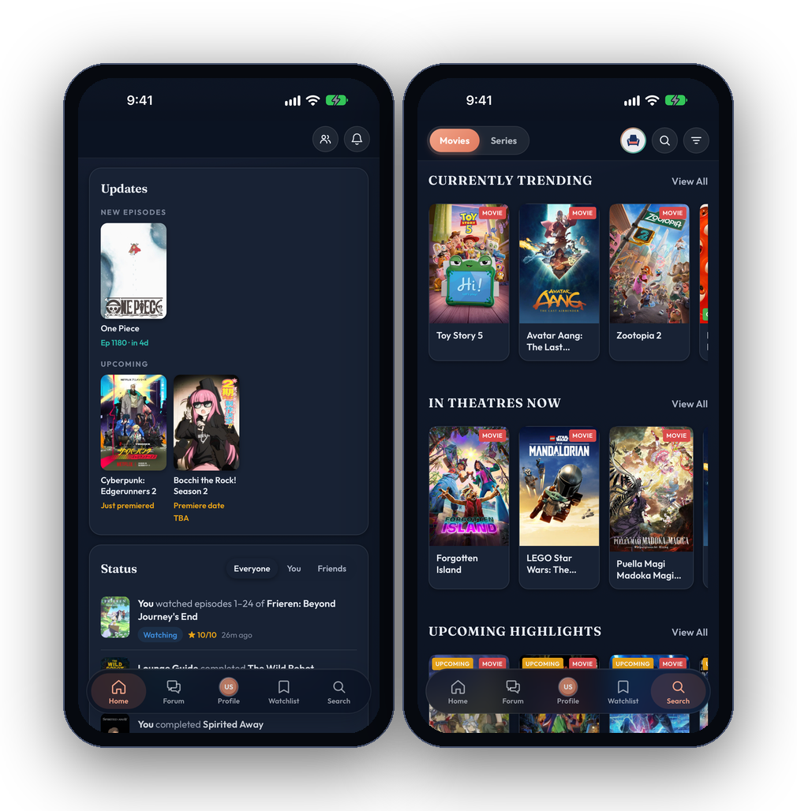
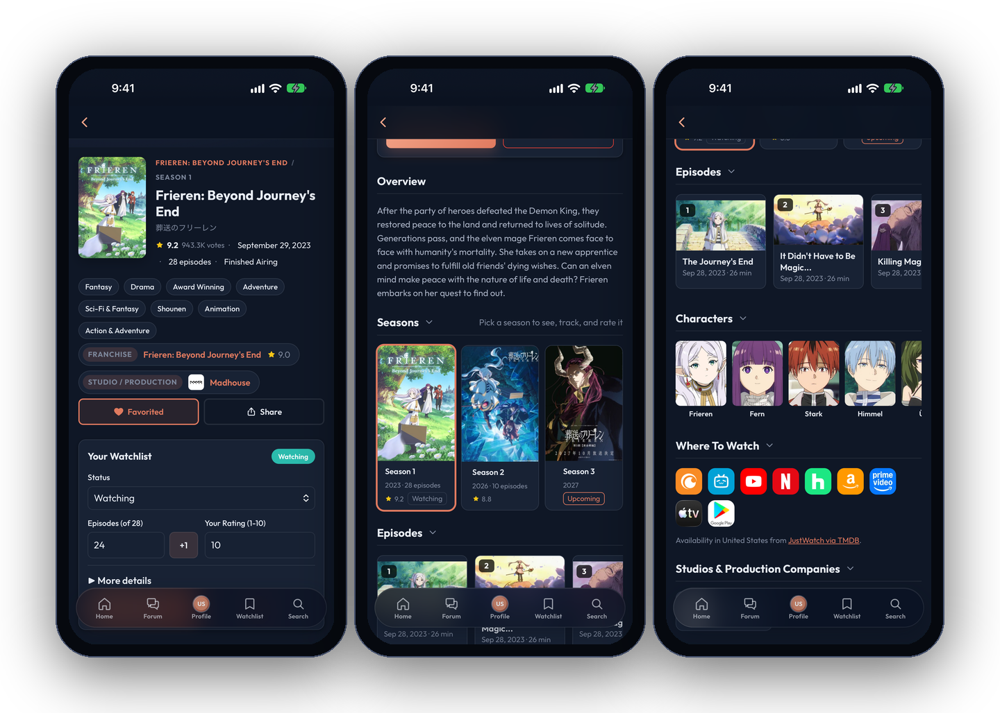
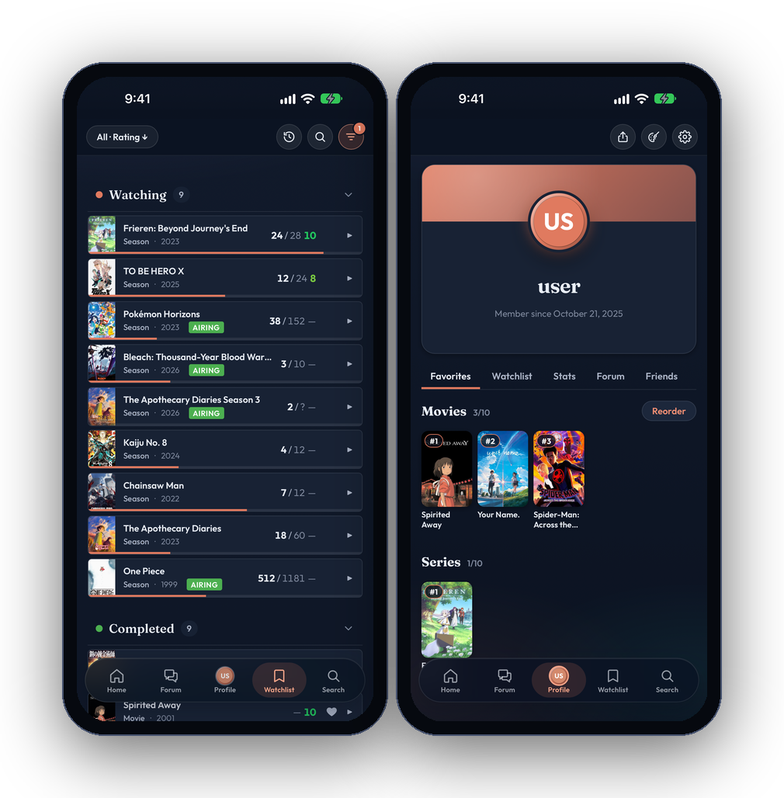
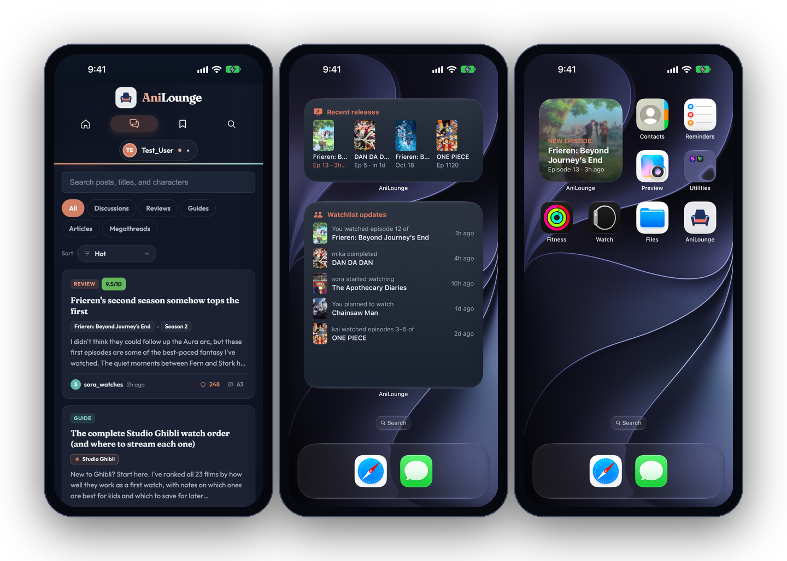

# AniLounge - Beta Release
A full-stack web and iOS application for discovering, filtering, rating, and tracking animated television shows and films.

Beta Release: https://anilounge.net

Want to look around without signing up? Use the shared demo account:
 - Email: demo@findanimation.com
 - Password: DemoPassword123!

The demo account is shared by everyone, so it can't post in the forums, send messages, add friends, or change its name, password, picture, or bio. Anything else you change on it resets every night. Create a free account to join in.
   
Features --
 - Search & Filter: Browse through an extensive collection of animated content
 - AI Recommendations: Gemini integration helps you find information about the vast catalogue available
 - Watchlist Management: Track shows and movies you want to watch
 - Rating System: Rate and review your favorite animations
 - Forum Boards: Bond with people across the world on your favorite movies and series
 - User Profiles: Personalized profiles with viewing history and preferences
 - Customizable Settings: Tailor your experience to your preferences

MEVN --> PEVN Stack Architecture --
 - MongoDB - NoSQL database for flexible data storage (old)
 - PostgresSQL - SQL relational database for recording complex relationships of data
 - Express.js - Backend web application framework
 - Vue.js - Progressive frontend JavaScript framework
 - Node.js - JavaScript runtime environment

APIs & Integrations --
 - TMDB API - Movie and TV show database
 - MyAnimeList API - Anime-specific content and metadata
 - Google Gemini API - AI-powered features and recommendations

Local development -- see [CONTRIBUTING.md](CONTRIBUTING.md#setting-up)

Contributing -- see [CONTRIBUTING.md](CONTRIBUTING.md) to set up the project, and [GIGS.md](GIGS.md) to find and claim a task.

Deployment --
 - Frontend: Vercel
 - Backend: Railway

## Home

Your status feed, what friends are watching, and what's trending.

## Titles

Scores, studios, seasons, episodes, characters, and your progress on every movie and series.

## Watchlist and Profile

Track watching, planned, and completed titles, and show off your stats.

## Forum and iOS Widgets

Episode threads, reviews, and guides, plus home screen widgets for new releases and friends' activity.

Author: Anirudh Naveen

Note: This is a beta release. Some features may be under active development.

## License

Copyright (C) 2025-2026 Anirudh Naveen. AniLounge is free software, licensed under the [GNU Affero General Public License v3.0](LICENSE).
